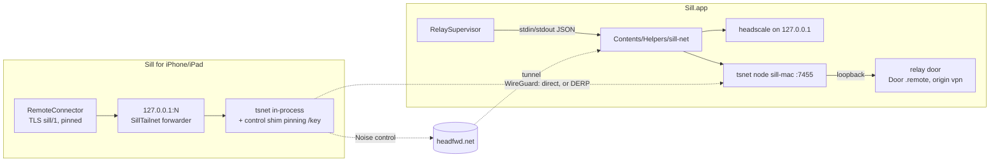

# Reach from Anywhere: the Mac's own tailnet through a HeadFwd relay

Branch `headfwd` from main at 4d990e9, by Dan Pastusek (pastudan), for Noah's review. Not asked for
in an issue first, against the README's request; this doc is the proposal as much as the record, and
the change is opt-in at every level (off by default on the Mac, nothing changes for a device until
that Mac turns it on).

## The problem

Remote Access today (docs/remote-access-plan.md) reaches a Mac away from home in two ways:

- **The person's own VPN**: Tailscale (the easy one) or WireGuard into the home network. Both need an
  account or a router that runs one, an app on the Mac and on every device, and the VPN switched on
  before Sill can connect.
- **A port forward** on the home router, behind "Allow connections from the internet". Many homes
  can't: carrier-grade NAT, double NAT, a router the person doesn't control. DEVELOPMENT.md spends
  80 lines on these.

The brief names the gap (docs/BRIEF.md, "Our angles"): *remote access without requiring Tailscale
(later)*, and plans CloudKit signalling with ICE hole punching for it. This change is a way to close
that gap now, with code that already runs in two other apps.

## The design in one paragraph

The Mac runs its own private tailnet: a Headscale control plane on loopback, and a userspace tsnet
node. A free HeadFwd relay (headfwd.net) carries only that control plane's Noise-encrypted traffic
to and from a Mac behind NAT. A paired device, on a session with that Mac, gets a single-use key
over its pinned TLS and joins the tailnet inside the app: no VPN profile, no NetworkExtension.
Packets then flow over WireGuard, directly when the networks allow and through Tailscale's public
DERP relays when they don't. What travels inside is **Sill's own TLS 1.3 with both keys pinned**, to a
door of its own on the Mac with the remote door's rules. The tailnet is a path, never a trust anchor.

## Threat model

What each party sees and could do, if it were hostile:

| Party | Sees | Worst case |
|---|---|---|
| headfwd.net (or any relay) | The Mac's control fingerprint (public), Noise-encrypted control bytes, timing | Refuses service. It cannot read control traffic, register as this Mac (registration proves the Noise private key, HeadFwd's X25519 + HMAC challenge), pose as this Mac to a device (the device pins the control key against the fingerprint the Mac sent over pinned TLS, before it sends its preauth key: the shim answers `/key` itself from then on), or send a device to another Mac (the URLs it returns are checked exactly against `https/wss://<fingerprint>.<configured domain>`, HeadFwd df777ef). |
| Tailscale's DERP | WireGuard ciphertext between two node keys | Refuses service. Inside WireGuard is Sill's own TLS anyway. |
| The Mac's own Headscale | Everything a control plane sees | It is the Mac's; and even it cannot get a device into a session: the relay door admits only paired keys, by the same pins as every other door. |
| Another device on this tailnet | Its own node | Its ACL lets it reach `tag:sill-mac:7455` alone: not another device, not another port on the Mac (checked live, below). |
| Another app on the iPhone | 127.0.0.1:N while Sill runs | The forwarder goes only to `sill-mac:7455`, where Sill's door wants a paired key it doesn't have. |
| Another process on the Mac | The relay door on 127.0.0.1 | What it can already reach: the remote door. Same rules, same keys. |

What leaves the Mac that didn't before: the control fingerprint, to headfwd.net; and when a direct
path fails, ciphertext through Tailscale's DERP. No log upload (`SetNoLogsNoSupport`, logtail off),
no account anywhere. The device stores the fingerprint and relay domain on its saved Mac, never the
preauth key, and its tsnet state is excluded from backups.

## Components

### Mac

- **`Helpers/sill-net`** (Go, ported from Frigate Launcher's `nvrd`, itself from Bridge's
  tailnet sidecar; the relay client is wire-compatible with HeadFwd at registration protocol v2,
  its crypto test vector shared):
  - Runs Headscale (pinned v0.29.4 in its `go.mod`/`go.sum`, **built into sill-net** and started as
    `sill-net headscale serve`, so the Go runtime, tsnet and gvisor ship once) as a supervised child
    on a free loopback port, with a config and a **static ACL policy** it writes. That child stops by
    itself if sill-net dies, even by SIGKILL (macOS has no parent-death signal: it watches its
    parent), and a stale one from a crash is stopped at the next start only if it runs that exact
    command:
    `tag:sill-device` → `tag:sill-mac:7455`, nothing else, no SSH.
  - Settles Headscale's admin API key (rotating before expiry), registers with the relay, holds the
    WSS tunnel, and brings up the tsnet node `sill-mac` that forwards :7455 to the relay door.
  - Mints single-use, ten-minute, tagged preauth keys, one per ask, and records them per paired
    device (`internal/ledger`): Remove on the Mac deletes exactly that device's nodes and expires its
    keys; devices removed while sill-net was not running are removed at its next start.
  - Talks to Sill over stdin/stdout JSON lines (`start`/`invite`/`remove`/`paired`/`door`/`stop`;
    `status`/`invite`/`removed`/`error`). No admin port, no token. Exits when stdin closes, so it
    never outlives Sill; Headscale goes with it.
- **`RelaySupervisor`** (Sources/SillHost): runs `Contents/Helpers/sill-net` while Remote Access
  *and* Reach from Anywhere are on, restarts it with backoff, logs its stderr as `sill-net:` lines,
  and turns its events into `RemoteStatus.relay` and kind 18's `relay`.
- **`RelayDoor`**: a third listener, `Door(.remote)` on 127.0.0.1 with a port the system picks. Its
  arrival is fixed (`Door.fixedArrival`): origin `.vpn`, label "through Sill Relay", and no
  per-source backoff (one source is every device). It must not classify as `.loopback`, which the
  rules treat as this Mac itself.
- **`HostConfig.reachFromAnywhere`**: the Mac's alone, like Remote Access (absent from every device
  path). Settings › Remote Access gains "Reach from Anywhere" with one line of state and a footnote
  naming headfwd.net and DERP. `SillHost --remote --relay` for tests.

### Wire (additive; an older peer is unchanged)

- `MacInfo.relay: RelayInfo?` (kind 18, signed): `{fingerprint, domain}` while the tailnet is up. Nil
  is left out of the JSON, so a Mac without it signs the same bytes as before.
- Kind **61** `relayJoin`, device → host, `{}`: ask for a key, on a paired session.
- Kind **60** `relayInvite`, host → device: `{relay, key}`, to the connection that asked alone.
- 60 and 61, not 33: open pull requests use 33 through 46 (audio, files, camera, microphone, pencil).
- **RelayPolicy** (pure, both ends): the host gives a key to a paired key's session while the
  tailnet is up, once per 30 s per connection; the device asks a pinned session's saved Mac that
  offers a tailnet it hasn't joined, once a session, and takes a key only for the tailnet that
  session's signed kind 18 offers.

### Device

- **`Helpers/tailnet-mobile`** → `SillTailnet.xcframework` (Go c-archive, a seven-function C API,
  ported from Frigate Launcher's). The control shim verifies the relay's `/key` against the
  fingerprint before tsnet ever sees the preauth key, pins it, and answers `/key` locally afterwards.
  Bridge's SOCKS proxy is replaced with a **forwarder**: a loopback port whose every connection goes
  to `sill-mac:7455` and nowhere else. Reviving listeners survive iOS reclaiming sockets; recovery
  runs on a network change and on return to the foreground.
- **`TailnetController`** wraps it; **`StreamClient+Relay`** asks and takes; `dialSaved` dials the
  saved addresses at once while the tailnet starts, then the forwarder (first when it won last
  time). The route reads "through Sill Relay" and counts as away (60 fps, the away quality).
- The Xcode project gains an aggregate target `SillTailnet` (runs `Scripts/make-tailnet.sh`; a script
  phase in the app target made a build cycle with the framework it produces) and `-lresolv`.
- `PrivacyInfo.xcprivacy` declares **FileTimestamp (C617.1)**: the Go runtime links `stat`/`fstat`,
  used on the tailnet's own state in the app's container.

### Build and release

- `Scripts/make-helpers.sh` (sill-net with Headscale built in, `CGO_ENABLED=0`, `-trimpath`, universal under
  `SILL_UNIVERSAL=1`) and `Scripts/make-tailnet.sh` (the xcframework), each skipped when its inputs'
  hash is unchanged.
- `make-app.sh` copies the helper into `Contents/Helpers` and signs it first (hardened runtime;
  a timestamp on a release); `SILL_NO_RELAY=1` skips them for development and is refused with
  `--release`. `release.sh` checks the helper's Developer ID, runtime, timestamp and architectures.
  `release-ios.sh` refuses an app whose binary lacks `SillTailnetStart`.
- CI, Release and TestFlight set up Go (`actions/setup-go`, pinned by SHA). CI also vets, tests and
  gofmt-checks both modules, builds Sill.app with its helpers (ad hoc) and checks them, and runs the
  relay check's mutants. Nothing new reads a secret.

## The cost against the house rules (for Noah to decide)

This breaks three of CLAUDE.md's conventions, on purpose, and asks for a dated decision:

1. **"Swift and Apple frameworks only"**: three Go dependency trees (HeadFwd's relay client and
   Bridge's tailnet code, ported here; Headscale, BSD-3; tailscale.com, BSD-3), built from pinned
   versions with checksums in `go.sum`. The Swift side imports nothing new.
2. **"Nothing that needs a server"**: two servers Sill doesn't run, both optional: headfwd.net
   (control only; free, run by Dan; HeadFwd's proxy is open source and a Mac can point at any
   instance with `defaults write me.saffer.sill.mac RelayURL https://…`), and Tailscale's DERP (only
   when a direct path fails). Zero operating cost for Sill.
3. **Size**: Sill.app 7.3 MB → 54 MB uncompressed (one 49 MB helper, arm64); the zipped download
   grows by about 14 MB. Measured: Headscale's own code is under 1 MB; the rest is what any
   tsnet/WireGuard control plane carries: the Go runtime and its function tables (about 18 MB of
   `__gopclntab`), tsnet and gvisor's netstack, crypto, gRPC/protobuf (Headscale's API), its SQLite
   (a pure-Go port, 1.9 MB) and the Postgres driver it always links (1.3 MB). Shipping Headscale as a
   separate binary cost 20 MB more (73 MB): the two shared 7.9 MB of 8.3 MB of code. Tailscale's
   `ts_omit_*` build tags save only 0.3 MB on top, and some that compile panic at runtime (peerapi),
   so none are used. Dropping SQLite or Postgres needs a fork of Headscale. The iOS app gains the Go
   runtime and tsnet (a 50 MB static archive before dead-stripping; to be measured on the App
   Store's thinned download).

What it buys: the brief's "remote access without requiring Tailscale", with no VPN app, no account,
no router settings, through CGNAT and double NAT, with the security story unchanged (Sill's own pins
end to end).

## Open questions, with the default taken

1. **On by default?** Off, under Remote Access, which is off by default. It reaches the internet.
2. **Which relay?** headfwd.net, overridable by a default (no UI). A second built-in relay (Bridge's
   `bridgeproxy.net`) could be a fallback; left out until someone runs it for Sill.
3. **Export compliance.** WireGuard is not Apple's crypto. `ITSAppUsesNonExemptEncryption` stays NO
   under the standard-algorithms exemption that WireGuard and Tailscale apps use; Noah to confirm
   in App Store Connect.
4. **Joining from the QR code** (decided 2026-10-21, Dan): the pairing window's QR code carries the
   tailnet (`&r=<domain>&f=<fingerprint>&t=<key>`, about 340 bytes, still a QR code a phone reads at
   once), so scanning it joins the tailnet at once, and the pairing itself goes through the relay when
   none of the link's addresses answers: no session at home first, and no VPN. The key is the
   window's alone: single use, ten minutes, minted when the window opens (the code is offered again
   with it once the tailnet is up) and expired, with any node that joined with it, when the window
   closes unused; the device that pairs through it owns it (sill-net's ledger: `claim`), so Remove
   removes that node. It adds nothing an attacker could use that the code doesn't already give: the
   QR code's secret pairs the device, and the key only reaches the door that asks for that pairing.
   Devices paired before Reach from Anywhere was on still join over a session (kinds 61 and 60).
5. **Licensing.** The ported Go is contributed under Apache-2.0; HeadFwd's own code it derives from is
   MIT (Dan's), Headscale and tailscale.com BSD-3. A ThirdPartyNotices file should ship in both apps
   before a release (not in this change).
6. **iOS memory.** tsnet inside the app costs memory and some battery while it runs; it runs only
   while a saved Mac with a relay is dialed or streamed. To be measured on a device.

## Results (2026-10-20, on Dan's Mac, Xcode 27.0)

- **Go**: `go vet` and `go test` pass in both modules (sill-net: headscale, ledger, relay with
  HeadFwd's strict URL check and its proof vector; tailnet-mobile: invite, shim, forwarder, reviving
  listeners, recovery).
- **Pure checks**: `Tests/checks/run-all.sh` all 47 checks pass (the new `relay`: 96 checks, 33 of 33
  mutants; `away-quality` and `pointer-control` extended).
- **Live, sill-net alone, against the real headfwd.net**: registration with the strict check; a
  device (tailnet-mobile's `cmd/tailnet-try`, the same package the xcframework wraps) joins in
  2.8 s and reaches the door; rejoins without a key in 0.25 s; after Remove, it is refused
  (`PhaseRemoved`). **ACL**: from a second device, `sill-mac:7455` reached, Headscale's port, port 22
  and the other device's ports refused.
- **Live, SillHost `--remote --relay`**: "Reach from Anywhere: ready, through headfwd.net"; a
  paired client (sillclient `--relay-join`) gets kind 18 with `relay` and a kind 60; a device joins;
  a pinned session through the forwarder streams 60 fps, the Mac logs "Remote client connected …
  through Sill Relay" and runs the away quality; a wrong pin and an unpaired key are refused through
  the relay; killing SillHost takes sill-net and Headscale with it.
- **Live, the iOS app in the simulator** (iPhone 17 Pro): paired at 127.0.0.1, asked, took the key,
  joined through headfwd.net in about 2.5 s; relaunched with every saved address replaced by
  192.0.2.1 (nothing answers), it connected "through Sill Relay" and streamed at 60 fps.
- **Sill.app**: built with its helper, ad hoc, `codesign --verify --strict --deep` passes; the
  bundled sill-net runs its built-in Headscale. With Headscale built in (2026-10-21), the live tests
  above were run again: registration, join, the ACL, Remove, SillHost `--relay` streaming through
  the relay, and a SIGKILLed sill-net whose Headscale stops by itself.
- **Builds**: `swift build` clean; the iOS app builds for the simulator, but only with a local stub of
  `DuoPostureReader.swift`'s iOS 27.1 calls, since this Mac has Xcode 27.0 only (origin/main fails
  here the same way; CI uses the 27.1 beta).

- **Review (2026-10-21)**: a read-through of the Swift side found seven problems, all fixed in their
  own commit and checked again live: sill-net's list of paired devices went stale after a pairing (a
  restart would prune the new device's node); a key could go to a device removed meanwhile; lines
  from a sill-net being stopped could overwrite the new one's state, and a quick off and on ran two;
  SIGPIPE could kill the CLI; the device kept the tailnet before the join worked, and then never
  asked again; a cancelled wait for the tailnet spun for 8 s; and that wait didn't count as a dial
  in flight, so the reconnect could start another.
- **Fork CI** (pastudan/sill): CI green on the iOS 27.1 SDK, with every check's mutants; the Release
  workflow's verify job green on a temporary tag (no secrets, nothing published). The TestFlight
  workflow stops at its Xcode check on GitHub's image as it does on main (it selects 27.0 and
  release-ios.sh wants 27.1), so the archive was not exercised in CI.

## Untested, for a device (Dan and Noah)

1. An iPhone on cellular, Wi‑Fi off, no Tailscale installed: pair at home, leave, connect "through
   Sill Relay". Latency against the same Mac through Tailscale.
2. UDP blocked (a guest Wi‑Fi that allows only TCP 443): the DERP path, and its latency.
3. The Mac restarted and the iPhone relaunched: rejoin with no new key.
4. Remove the iPhone on the Mac: its node gone, its next dial through the relay refused.
5. The relay down mid-session (block headfwd.net): the session carries on over WireGuard; a new
   join fails with the relay's words.
6. A Release build: the App Store's thinned size, memory while streaming, battery over an hour.
7. Developer ID signing and notarization of the helpers (CI's publish job, or `release.sh`).
